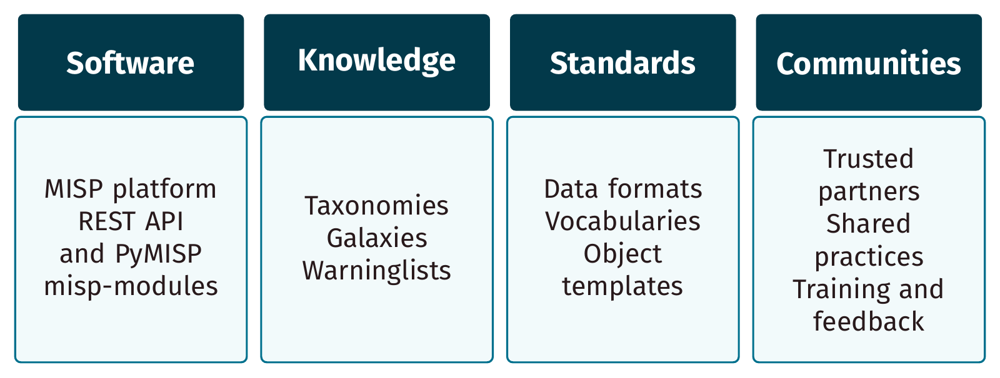
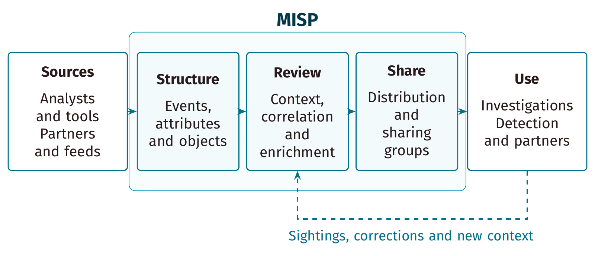
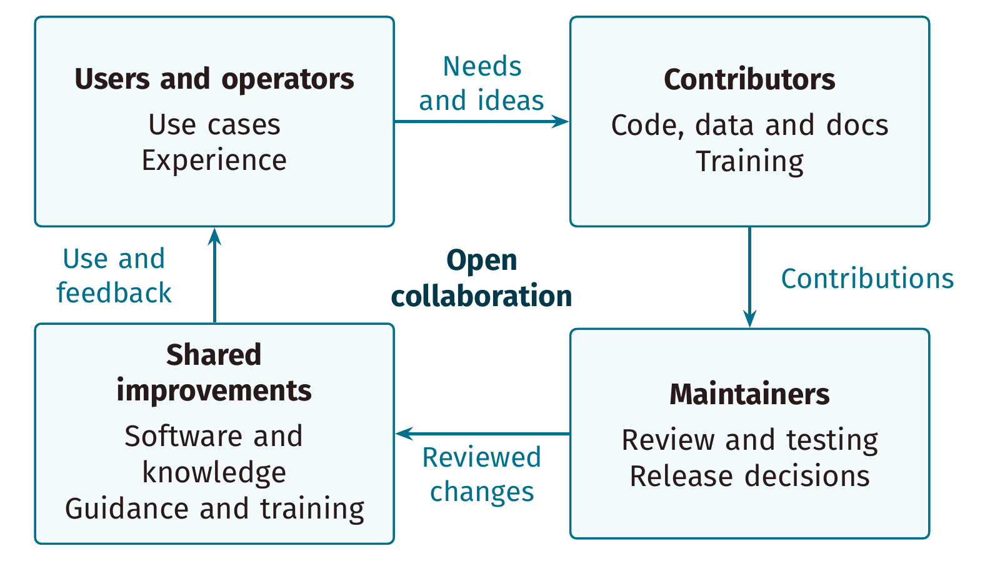

# Sharing information with MISP

**A short introduction to useful information, deliberate sharing and feedback.**

[English PDF](../output/0-intro-shorter.pdf) · [Español](../output/0-intro-shorter_es.pdf) · [Nederlands](../output/0-intro-shorter_nl.pdf) · [Editable diagrams](diagrams/README.md) · [Training home](../README.md)

Each edition has **18 pages**, including a title and **17 content slides with
presenter notes**. Allow 15–20 minutes plus a five-minute discussion. The lesson
is for new analysts, responders, managers and sharing-community members. It
requires no MISP account, API key or technical setup.

| Language | Entry point | Content and presenter notes |
| --- | --- | --- |
| English | [slide.tex](slide.tex) | [content.tex](content.tex) |
| Español | [slide_es.tex](slide_es.tex) | [content_es.tex](content_es.tex) |
| Nederlands | [slide_nl.tex](slide_nl.tex) | [content_nl.tex](content_nl.tex) |

## What the introduction teaches

Learners should be able to explain what MISP shares, why context matters, how
to choose an audience and action, and how feedback improves information quality.
The same sequence and synthetic case are used in all three languages:

1. Two teams see the same domain in different reports. What does that establish?
2. Events, attributes, objects, tags and Galaxies keep observations interpretable.
3. Sources flow through structure, review and sharing controls to useful outputs.
4. A correlation is a lead to investigate; it does not prove attribution.
5. Investigation, detection and blocking need different decision policies.
6. Distribution, sharing groups, handling expectations and publication need review.
7. Communities and contributors improve both the information and the platform.

The case uses `login-support.example` and `192.0.2.25`, reserved documentation
values. They are fictional teaching observations, not malicious indicators or
a production blocklist. The closing exercise can be done on paper. If a trainer
uses an authorised lab, keep the disposable event unpublished and
organisation-only; this introduction does not ask learners to publish it.

The lesson deliberately removes the old external agenda shortlink, undated user
counts, long feature inventories and legacy UI screenshots. It retains the
project's practical origins and the four complementary parts of its overview:
software, knowledge, standards and communities. Current capabilities are
described at an introductory level, with detailed setup left to follow-on courses.

## Editable diagrams

The slide decks **input the TikZ source directly**. Text is not baked into a
bitmap or a pre-rendered PDF. All languages use the same geometry and styling;
the editable labels live in separate language files.

| Diagram | Editable geometry | English vector export |
| --- | --- | --- |
| MISP project overview | [overview.tikz](diagrams/overview.tikz) | [PDF](diagrams/overview.pdf) |
| Information-sharing flow | [sharing-flow.tikz](diagrams/sharing-flow.tikz) | [PDF](diagrams/sharing-flow.pdf) |
| Community contribution cycle | [community.tikz](diagrams/community.tikz) | [PDF](diagrams/community.pdf) |







The overview preserves the earlier four-part idea while replacing obsolete
component examples. The flow is conceptual, rather than a promise that every
input automatically passes a fixed pipeline or is published. Its dashed arrow
means feedback. The community diagram explains contribution and review; it is
not a formal legal or organisational authority chart. People can occupy several
roles and the repositories have their own contribution processes.

See the [diagram editing and export guide](diagrams/README.md) for labels,
geometry, fonts, standalone builds and PNG previews. Reuse the materials under
the repository's [existing license and attribution terms](../README.md#license-attribution-and-funding).

## Use the presenter notes

Every content slide has a localised `\note{...}` block. Notes explain the
synthetic case, common misconceptions, discussion prompts and the limits of
each diagram. The standard training build creates the English notes handout;
the same Beamer second-screen setup also works for Spanish and Dutch.

Ask learners:

- Which source, time and uncertainty information would Team B need?
- Why might a correlation justify a search but not an automatic block?
- Who should receive the record, and which settings enforce that choice?
- What should happen when the observation is corrected or no longer useful?

TLP describes handling expectations. A TLP tag alone does not grant or enforce
MISP visibility; use distribution and sharing groups under the applicable
policy. Warninglists, enrichment, sightings and age/decay help review but do not
replace source assessment or local judgment.

## Build the decks and diagrams

Use the [shared theme setup](../themes/README.md): a recent TeX Live with Beamer,
TikZ, Fira Sans/Fira Mono, `standalone`, `booktabs` and `array`. The ordinary
`pdflatex` build requires no shell escape, image-generation service or MISP server.

From the repository root:

```sh
export TEXINPUTS="$PWD/themes:${TEXINPUTS:-}:"
mkdir -p /tmp/misp-short-intro
cd 0-intro-shorter
for source in slide slide_es slide_nl; do
  for pass in 1 2 3; do
    pdflatex -interaction=nonstopmode -halt-on-error \
      -output-directory=/tmp/misp-short-intro "$source.tex" || exit 1
  done
done
bash diagrams/build.sh /tmp/misp-short-intro/diagrams
```

The public entry-point filenames and the root build's selection are retained.
The shared [preamble](preamble.tex) loads the theme and diagram styles. The
earlier [slides, images and available published PDF](../archive/slide-decks/0-intro-shorter-v1/README.md)
remain in the archive outside the standard build.

## Continue with the relevant course

| Goal | Next course |
| --- | --- |
| Work with events and attributes | [MISP usage](../1-misp-usage/) |
| Classify and communicate handling | [Taxonomies and tagging](../3-misp-taxonomy-tagging/) |
| Add structured knowledge and context | [Galaxies](../3.2-misp-galaxy/README.md) |
| Group related observations | [Objects and templates](../3.3-misp-object-template/README.md) |
| Integrate tools | [REST API](../a.7-rest-API/README.md) and [PyMISP](../a.2-pymisp/README.md) |
| Operate a community | [Administration](../2-misp-administration/) and [sharing practices](../a.4-best-practices/) |

## References and review scope

Reviewed on **3 November 2026**, using the concepts documented for MISP 2.5.50:

- [MISP platform overview](https://github.com/MISP/MISP/blob/fc99c9e3fc85beddc6ef18835359f3c8b7f44608/README.md) and [contribution guidance](https://github.com/MISP/MISP/blob/fc99c9e3fc85beddc6ef18835359f3c8b7f44608/CONTRIBUTING.md).
- [MISP project](https://www.misp-project.org/), [standards](https://www.misp-standard.org/) and [communities](https://www.misp-project.org/communities/).
- [FIRST Traffic Light Protocol](https://www.first.org/tlp/), alongside MISP's own access controls.
- Reserved example domains in [RFC 2606](https://www.rfc-editor.org/rfc/rfc2606.html) and documentation IPv4 addresses in [RFC 5737](https://www.rfc-editor.org/rfc/rfc5737.html).
- The earlier introduction at [`c818ca9838e1466da08823f0f26a614c1c15f061`](https://github.com/MISP/misp-training/tree/c818ca9838e1466da08823f0f26a614c1c15f061/0-intro-shorter) for project history and the original four-part overview.

Validation covers all three standard and presenter-notes builds, nine standalone
diagram/language exports, rendered-page inspection, translation-label parity,
PDF text/image checks, local links, archive preservation and whitespace. These
are presentation/source checks; this update does not claim new live-server,
sharing-permission or production-integration tests.
