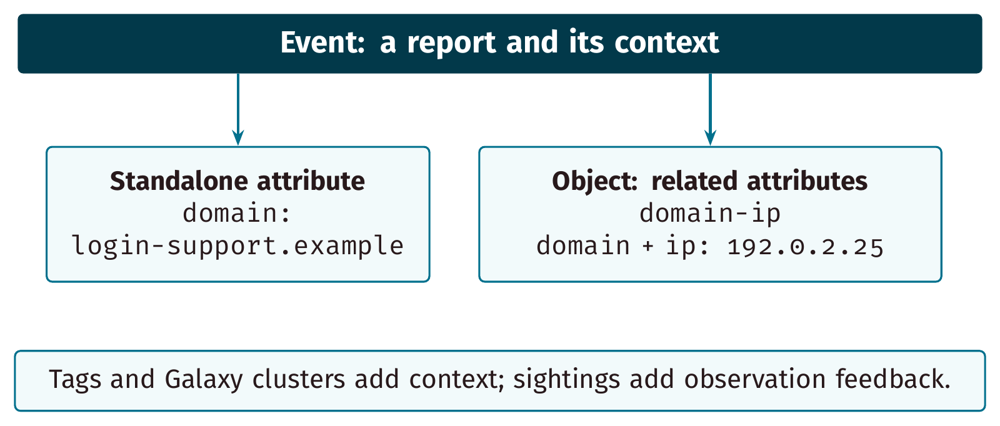
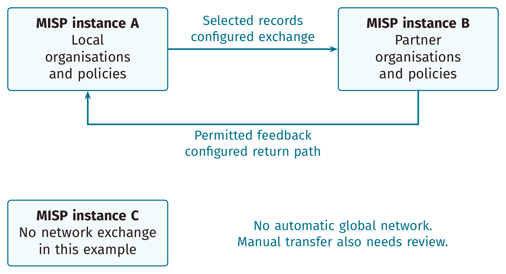

# An introduction to information sharing

**From observations to useful decisions with MISP.**

[English PDF](../output/0-misp-introduction-to-information-sharing.pdf) · [Nederlandse PDF](../output/0-misp-introduction-to-information-sharing_nl.pdf) · [Editable diagrams](diagrams/README.md) · [Training home](../README.md)

The English and Dutch editions follow the same **31-page lesson**, including a
cover and **30 content slides with localised presenter notes**. Allow 35–40
minutes, plus ten minutes for the discussion exercise. No account, API key or
technical setup is required. For a shorter session, use the separate
[15–20 minute introduction](../0-intro-shorter/README.md).

| Edition | Entry point | Content and presenter notes |
| --- | --- | --- |
| English | [slide.tex](slide.tex) | [content.tex](content.tex) |
| Nederlands | [slide_nl.tex](slide_nl.tex) | [content_nl.tex](content_nl.tex) |

## Learning sequence

The course is for analysts, responders, community operators and other newcomers.
It gives learners a vocabulary and a decision process before they configure MISP:

1. Follow a fictional investigation across two teams.
2. Model observations with events, attributes, objects and reusable context.
3. Assess a correlation and distinguish investigation, detection and blocking.
4. Choose an audience, review handling expectations and understand publication.
5. Compare synchronisation, feeds, API/export and manual exchange.
6. Use provenance, sightings, observation times and decay to support review.
7. Agree community responsibilities and practise a small contribution.

The example uses `login-support.example` and `192.0.2.25`, reserved documentation
values. They are synthetic observations, not malicious indicators or a blocklist.
The exercise can be done on paper. In an authorised lab, use disposable records,
keep the event organisation-only and unpublished, and inspect configured
consumers. Unpublished is not a secrecy control: authorised users may still see
or retrieve records. Instance administrators may have privileged access.

## What changed and why

Both languages now teach the same concepts in the same order. Dense feature
inventories and legacy UI screenshot sequences have been replaced with focused
explanations and editable diagrams. This is a conceptual introduction; current
UI procedures, API methods and model configuration belong in the practical
follow-on courses.

The material retains the project's practical origins, CIRCL's long-standing
role and the four-part overview of software, knowledge, standards and communities.
Undated community counts, outdated institutional descriptions, TLP:WHITE wording
and claims that a correlation confirms a campaign are no longer current guidance.
The complete earlier sources, static artwork and original published English and
Dutch PDFs are preserved in the [documented archive](../archive/slide-decks/0-misp-introduction-to-information-sharing-v1/README.md).

## Editable diagrams

All eight diagrams are **TikZ source**, compiled directly into the slides with
selectable text and vector shapes. Shared geometry and separate English/Dutch
label files keep edits and translations in step.

| Concept | Editable source | English vector PDF |
| --- | --- | --- |
| Project overview | [Shared TikZ](../0-intro-shorter/diagrams/overview.tikz) | [PDF](../0-intro-shorter/diagrams/overview.pdf) |
| Information flow | [Shared TikZ](../0-intro-shorter/diagrams/sharing-flow.tikz) | [PDF](../0-intro-shorter/diagrams/sharing-flow.pdf) |
| Contribution cycle | [Shared TikZ](../0-intro-shorter/diagrams/community.tikz) | [PDF](../0-intro-shorter/diagrams/community.pdf) |
| Event, attributes and object | [TikZ](diagrams/data-model.tikz) | [PDF](diagrams/data-model.pdf) |
| Correlation as a lead | [TikZ](diagrams/correlation.tikz) | [PDF](diagrams/correlation.pdf) |
| Selected instance exchange | [TikZ](diagrams/exchange.tikz) | [PDF](diagrams/exchange.pdf) |
| Observation and record time | [TikZ](diagrams/timeline.tikz) | [PDF](diagrams/timeline.pdf) |
| Quality review cycle | [TikZ](diagrams/quality-cycle.tikz) | [PDF](diagrams/quality-cycle.pdf) |





The three shared diagrams and style definitions are reused from the short
introduction, rather than copied. This course adds its own label wrappers and
five diagrams. Both courses must be present in the repository checkout; building
this course does not require building the short deck first. All sixteen
language/diagram combinations can be exported independently by the supplied
script. See the [editing and export guide](diagrams/README.md).

The diagrams simplify concepts: the data model is not a full schema; arrows do
not grant trust or visibility; the timeline is fictional; and the contribution
cycle is not a formal legal or organisational authority chart.

## Presenter notes and exercise

Every content slide has a localised `\note{...}` block with explanations,
misconceptions, limits and prompts. The closing exercise asks participants to
explain the source and uncertainty, an object relationship, a permitted audience,
a justified action and a correction path. The debrief gives assessment criteria
without pretending that every organisation has the same policy.

Ask what changes if the IP is shared infrastructure, the source retracts a claim,
or the activity happened months ago. A useful answer distinguishes observation
from assessment, preserves provenance and states what remains unknown.

## Build

Use the repository's [shared TeX/font setup](../themes/README.md), including
Beamer, TikZ, Fira Sans/Fira Mono, `standalone`, `booktabs` and `array`.
No server, network access or shell escape is needed for compilation.

From the repository root:

```sh
export TEXINPUTS="$PWD/themes:${TEXINPUTS:-}:"
mkdir -p /tmp/misp-sharing-intro
cd 0-misp-introduction-to-information-sharing
for source in slide slide_nl; do
  for pass in 1 2 3; do
    pdflatex -interaction=nonstopmode -halt-on-error \
      -output-directory=/tmp/misp-sharing-intro "$source.tex" || exit 1
  done
done
bash diagrams/build.sh /tmp/misp-sharing-intro/diagrams
```

The existing filenames and standard build selection remain. The root build also
produces the English notes handout. For either edition, insert this setup before
`\begin{document}` and compile a separate copy from the course directory:

```tex
\usepackage{pgfpages}
\setbeameroption{show notes on second screen=right}
```

## Continue learning

| Need | Course |
| --- | --- |
| Work with records | [MISP usage](../1-misp-usage/) |
| Classify information | [Taxonomies and tags](../3-misp-taxonomy-tagging/) |
| Add structured context | [Galaxies](../3.2-misp-galaxy/README.md) and [objects](../3.3-misp-object-template/README.md) |
| Model information | [MISP data model](../a.11-misp-data-model/) |
| Integrate tools | [REST API](../a.7-rest-API/README.md) and [PyMISP](../a.2-pymisp/README.md) |
| Exchange and enrich | [Feeds](../a.3-misp-feed/) and [modules](../3.1-misp-modules/README.md) |
| Review age and decay | [Indicator decay](../a.5-decaying-indicators/) |
| Operate a community | [Administration](../2-misp-administration/) and [sharing practices](../a.4-best-practices/) |

## References, attribution and validation scope

Reviewed on **3 November 2026**, against concepts in MISP **2.5.50**:

- [Platform overview](https://github.com/MISP/MISP/blob/fc99c9e3fc85beddc6ef18835359f3c8b7f44608/README.md) and [contribution guidance](https://github.com/MISP/MISP/blob/fc99c9e3fc85beddc6ef18835359f3c8b7f44608/CONTRIBUTING.md).
- Source definitions for [attribute distribution](https://github.com/MISP/MISP/blob/fc99c9e3fc85beddc6ef18835359f3c8b7f44608/app/Model/MispAttribute.php), [sighting types](https://github.com/MISP/MISP/blob/fc99c9e3fc85beddc6ef18835359f3c8b7f44608/app/Model/Sighting.php) and [event retrieval/export](https://github.com/MISP/MISP/blob/fc99c9e3fc85beddc6ef18835359f3c8b7f44608/app/Model/Event.php).
- [MISP project](https://www.misp-project.org/), [standards](https://www.misp-standard.org/), [communities](https://www.misp-project.org/communities/) and [CIRCL](https://www.circl.lu/).
- [FIRST TLP 2.0](https://www.first.org/tlp/). TLP labels complement MISP visibility controls.
- Reserved example domains: [RFC 2606](https://www.rfc-editor.org/rfc/rfc2606.html); documentation IPv4 addresses: [RFC 5737](https://www.rfc-editor.org/rfc/rfc5737.html).
- Earlier training at [`644d83458fa5f9cdca308006b86fc9b009c4dbfd`](https://github.com/MISP/misp-training/tree/644d83458fa5f9cdca308006b86fc9b009c4dbfd/0-misp-introduction-to-information-sharing).

Credit remains with CIRCL / Team MISP Project and the repository's contributors.
Reuse under the repository's [existing license, attribution and funding terms](../README.md#license-attribution-and-funding); the theme retains its own notices.

Validation covers both standard decks and presenter-notes builds, all sixteen
standalone diagram variants, rendered layouts, label parity, PDF text/image
checks, local links, shell syntax, archive preservation and whitespace. These
are presentation/source checks, not new live-server, permissions or production
integration tests.
