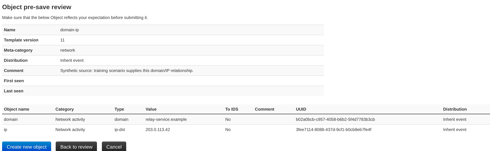
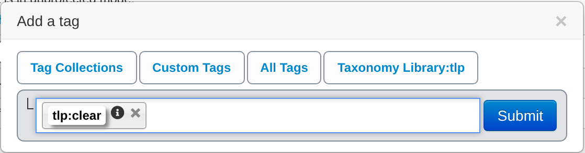

# MISP 2.5: everyday analysis

**Find, create, review and use a record.**

[English PDF](../output/1-misp-usage.pdf) · [Español](../output/1-misp-usage_es.pdf) · [Nederlands](../output/1-misp-usage_nl.pdf) · [Lab guide](lab/README.md) · [Screenshot reference](screenshots/README.md) · [Training home](../README.md)

The three editions follow the same **29-page lesson**, with a cover and **28
content slides with localised presenter notes**. Allow 60–75 minutes including
the checkpoints. Learners should understand the introduction's vocabulary and
have an authorised training account; a paper walkthrough is also possible.

| Edition | Entry point | Content and presenter notes |
| --- | --- | --- |
| English | [slide.tex](slide.tex) | [content.tex](content.tex) |
| Español | [slide_es.tex](slide_es.tex) | [content_es.tex](content_es.tex) |
| Nederlands | [slide_nl.tex](slide_nl.tex) | [content_nl.tex](content_nl.tex) |

## A practical sequence

1. Find an existing report and understand event context.
2. Create an organisation-only, unpublished event.
3. Add a typed domain and review the saved value and IDS flag.
4. Review free-text extraction before importing documentation IP addresses.
5. Inspect the `domain-ip` template, fill a relationship and complete its pre-save review.
6. Attach `tlp:clear` without broadening visibility.
7. Compare a real lab correlation and record one synthetic sighting.
8. Review publication permissions, cancel the confirmation and inspect a JSON download.
9. Explain the audience, justified next action and correction path.

The lesson replaces old VM credentials and repair commands, raster data-model
slides and feature-only demo prompts. Administration, feed configuration and
version-sensitive API examples now point to their maintained workshops.
The [earlier course and links to all three original publications](../archive/slide-decks/1-misp-usage-v1/README.md)
remain in the archive. Existing entry-point names and the standard build selection
are retained.

## Real MISP 2.5 screenshots

The course includes **16 browser captures from a running MISP 2.5.50 reference**,
using its default English interface. They are cropped application screenshots,
with no generated UI, added annotations or composited controls. Spanish and Dutch slides
translate instructions and notes while preserving the actual English UI labels.





The captures use synthetic reports and reserved documentation values. An ordinary
**User** performs the walkthrough; the publication confirmation alone uses a
separate non-admin **Publisher**, selects **No**, and leaves the event unpublished.
The default User role in this reference cannot publish. Labels, layout and available
actions can differ with patch version, role, settings, knowledge base and theme.

The [capture reference](screenshots/README.md) records image digests, version
checks, roles, template identity, routes and reproduction steps. A
[machine-readable manifest](screenshots/manifest.json) records dimensions and
SHA-256 hashes for every capture. No account passwords, API keys or browser
sessions are included.

## Trainer preparation and checkpoints

Use the [lab guide](lab/README.md), [reference report payload](lab/reference-event.json),
[free-text input](lab/freetext.txt) and [expected record](lab/expected-record.json).
The reference report is optional but must be visible to the learner for the
illustrated correlation to appear. Prepare the `domain-ip` object template and
TLP taxonomy before class, rather than assigning administrator rights to learners.

All case domains end in `.example`; addresses use documentation ranges. They
are not malicious indicators or a production blocklist. Keep the main and seed
events organisation-only and unpublished, clear every IDS flag, and inspect any
configured consumers. Organisation-only does not exclude privileged administrators;
unpublished records can still be read by authorised users and APIs.

A useful detail from the live walkthrough: free-text extraction classified a
bare reserved `.example` domain as a filename in this reference. The course adds
the domain explicitly and uses IP addresses for extraction. Review proposed
values, types, distribution and IDS instead of trusting parser guesses.

## Editable conceptual diagram

The data-model slide compiles the full introduction's [TikZ source](../0-misp-introduction-to-information-sharing/diagrams/data-model.tikz)
directly, with [local English, Spanish and Dutch labels](diagrams/README.md)
and the short introduction's shared style. The source remains editable and is
not an old raster screenshot. Both introduction directories must be present in
the checkout; neither needs to be compiled first.

UI screenshots document the reference application rather than editable interface
mockups. Recapture them from a running instance when the UI changes.

## Build and teach

Use the [shared TeX/font setup](../themes/README.md): Beamer, TikZ, Fira Sans/Fira
Mono, `booktabs` and `array`. From the repository root:

```sh
export TEXINPUTS="$PWD/themes:${TEXINPUTS:-}:"
mkdir -p /tmp/misp-usage
cd 1-misp-usage
for source in slide slide_es slide_nl; do
  for pass in 1 2 3; do
    pdflatex -interaction=nonstopmode -halt-on-error \
      -output-directory=/tmp/misp-usage "$source.tex" || exit 1
  done
done
```

Compilation needs no MISP server, network access or shell escape. The root build
also creates the English presenter-notes handout. For any edition, compile a
separate copy with this setup immediately before `\begin{document}`:

```tex
\usepackage{pgfpages}
\setbeameroption{show notes on second screen=right}
```

## Follow-on courses

| Need | Course |
| --- | --- |
| Shared vocabulary | [Short introduction](../0-intro-shorter/README.md) or [full introduction](../0-misp-introduction-to-information-sharing/README.md) |
| Classify and contextualise | [Taxonomies](../3-misp-taxonomy-tagging/), [objects](../3.3-misp-object-template/README.md) and [Galaxies](../3.2-misp-galaxy/README.md) |
| Review information age | [Indicator decay](../a.5-decaying-indicators/) |
| Integrate tools | [REST API](../a.7-rest-API/README.md) and [PyMISP](../a.2-pymisp/README.md) |
| Operate the instance | [Administration](../2-misp-administration/), [feeds](../a.3-misp-feed/) and [sharing practices](../a.4-best-practices/) |

## Reference and validation scope

Reviewed and captured on **3 November 2026**. The running reference reports
**MISP 2.5.50** in `VERSION.json`, startup output and its UI footer. The
[versioned source reference](https://github.com/MISP/MISP/tree/fc99c9e3fc85beddc6ef18835359f3c8b7f44608)
supports checks of form labels, distribution, permissions, sighting meanings and
exports. See also [FIRST TLP 2.0](https://www.first.org/tlp/),
[RFC 2606 example domains](https://www.rfc-editor.org/rfc/rfc2606.html) and
[RFC 5737 documentation addresses](https://www.rfc-editor.org/rfc/rfc5737.html).

Live checks verified creation and saved state, five exact values, one typed object,
cleared IDS flags, inherited distribution, the non-local `tlp:clear` association,
a real correlation, one UTC-timed sighting, the cancelled publication confirmation,
and the browser-downloaded JSON. A separate ordinary organisation received 404
when requesting the private event. This is a scoped lab check, not a full
permissions audit or a test of peer sync, mail delivery, feeds, enrichment,
cross-organisation proposals or production detection/blocking.

Presentation checks cover all three decks and presenter-notes editions, rendered
layouts, screenshot references/hashes, local links, JSON fixtures, archive
preservation and whitespace. Credit and the repository's existing
[license, attribution and funding terms](../README.md#license-attribution-and-funding)
remain with CIRCL / Team MISP Project and contributors; theme notices still apply.
