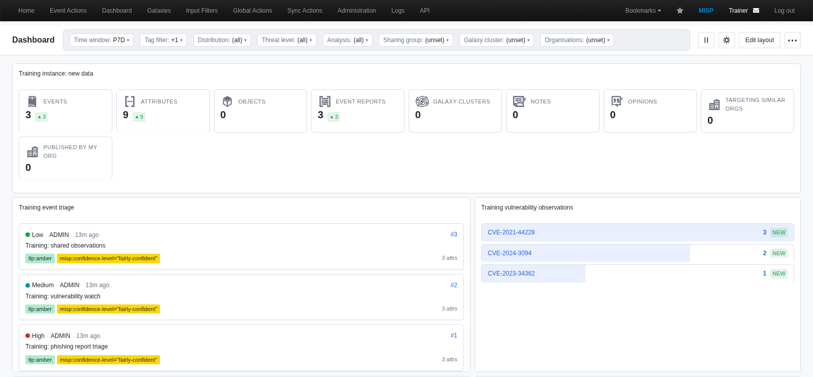

# The integrated dashboard in MISP 2.5

**Build a useful view, understand its scope.**

A practical course on the dashboard **inside MISP**, at `/dashboards`: choosing
widgets, configuring filters, saving a personal layout, reusing templates and
interpreting the results.

[Slides](slide.tex) · [Presenter notes](content.tex) · [Screenshots](images/misp25/README.md) · [Workshop](#workshop-build-inspect-restore) · [Source audit](#source-audit) · [Training home](../README.md)



## What changed in this course

The former presentation described the **separate ZeroMQ-based misp-dashboard**
application. Its sources, images and published PDF now live in the
[archive](../archive/slide-decks/6.0-misp-dashboard-zmq/README.md), outside standard
training. That application is distinct from the built-in dashboard taught here;
no standalone subscriber, dispatcher or Flask server is required for this board.

The new deck has **29 pages**: a title, 25 content slides and three section pages.
Allow about 30–40 minutes, plus 20–30 minutes for the workshop. Every content slide
has presenter notes. Five genuine browser screenshots show MISP **2.5.50**, using
the reviewed source, default theme, a site-admin training account and synthetic
events. They are not mockups or captures of production threat data.

Features depend on the deployed patch level, theme, available widgets and user
permissions. “Available in this reviewed 2.5 source” does not mean every feature
was introduced in the first 2.5 release.

## Read the dashboard correctly

| Concern | What to remember |
| --- | --- |
| Starting layout | A saved personal board takes precedence over an accessible default template. An explicitly saved empty board stays empty. |
| Layout changes | Add/move/resize/remove in **Edit layout**, then **Save changes** or **Discard**. |
| Widget settings | The panel's **Save** and shared-filter changes persist configuration separately. Layout Discard is not a general undo. |
| Shared filters | Apply only to widgets declaring that filter type. Read the affected count and mixed-state indicator. |
| Visibility | Detailed event views use event access rules; some summary metrics are instance-wide. There is no single visibility model for every widget. |
| Freshness | Automatic refresh, manual refresh and cached data are separate concerns. A refresh does not necessarily purge a cache. |
| Reuse | Templates and imported layouts configure a view; they do not grant data privileges. |
| Meaning | Counts, trends, inferred locations and ATT&CK tags are evidence summaries, not automatically severity, attribution or detection coverage. |

Examples of current contracts:

- **New data** includes global scale counts, organisation-contextual targeting
  and own-organisation publication metrics.
- **Trending** ranks distinct events per value. Momentum compares equal-length
  current/prior windows and is gated by a minimum count. All-time mode has no
  prior-window momentum. Its percentages differ from New data's count deltas.
- **Event Card Stream** inherits the Event Stream's filters and event access.
  Its `published` option is a boolean: false includes published and unpublished
  events. It does not declare the shared time-window filter in this snapshot.
- **Trending Tags** uses include/exclude substring patterns. Event Stream's
  `tags` input is instead a comma-separated string with `!` negation.
- **MISP Health** and some other operator widgets are site-admin-only. Inspect
  individual widget contracts rather than assuming all gallery entries are
  available to an analyst.

## Workshop: build, inspect, restore

### Prepare

Use an isolated MISP 2.5.50 training instance and a disposable user allowed to
create training events and use the relevant dashboard widgets. The screenshots
were captured with a site-admin account; learners do not automatically need
that role, and a narrower role may see fewer widgets/templates.

Open **Dashboard** or `/dashboards`. Export the current configuration through
**More → Export configuration** before replacing a personal board. Imports and
template selection change the current user's saved layout.

The shipped template manifests live in `app/files/dashboard-templates/`.
If the gallery lacks them, an administrator can use the template import control
or the existing CLI command from the deployed MISP directory:

```sh
sudo -u www-data app/Console/cake Dashboard importDefaultTemplates
```

This updates the template catalog and can prune orphaned built-ins; it is not
a harmless preview. Follow the deployment's normal operator workflow. A default
template does not overwrite a saved personal board on each visit.

### 1. Add the synthetic observations

These are three independent MISP JSON event requests:

| File | Purpose |
| --- | --- |
| [training-phishing.json](examples/training-phishing.json) | Synthetic phishing-report triage |
| [training-vulnerability-watch.json](examples/training-vulnerability-watch.json) | Synthetic vulnerability observations |
| [training-observations.json](examples/training-observations.json) | Synthetic shared-observation example |

Import each through the training instance's JSON event import, or POST each file
separately to `/events/add` with the normal REST client. Each request creates data.

The events are **organisation-only, unpublished and non-IDS**, with correlation
disabled on their attributes. Domains are reserved `.example` names. CVE values
are public identifiers used in invented observations, not reports of live
exploitation. No lookup, scan, external enrichment, feed or sync partner is needed.

The event UUIDs are fixed for repeatability. Reuse existing exercise events or
regenerate UUIDs before another import; do not assume duplicate imports create a
fresh corpus. Descriptive dates are fixture values; windowed widgets may use
server-generated data timestamps instead.

To populate **Training review reports**, add a short event report to each event,
for example:

```markdown
# Synthetic training report

Review scope, confidence and handling before using these observations.
No live incident data or provider lookups were used.
```

The screenshots include three such reports created separately. Importing the
three event files alone does not also create those reports.

### 2. Import the five-widget layout

Use **More → Import configuration** and paste
[dashboard-layout.json](examples/dashboard-layout.json). This replaces this
user's saved board; use the disposable account and retain the prior export.

| Tile | Configuration to inspect |
| --- | --- |
| Training instance: new data | Seven-day window and explicit demonstration country/sector context |
| Training event triage | Latest three events; published-only toggle off |
| Training vulnerability observations | Vulnerability dimension; five-row limit; minimum count one |
| Training review reports | Seven-day window; three-result limit |
| Training classification labels | Seven-day window; include `tlp:` tags |

The sample uses a bare widget array with `instance_id`, `widget`, `config` and
`position` (`x`, `y`, `w`, `h`). Do not invent a top-level `widgets` wrapper.

The minimum count of one is for demonstrating a tiny corpus. Do not interpret it
as a recommended production noise threshold. With only these three events, the
Trending CVE rows have distinct-event counts **3, 2 and 1**. Other pre-existing
data, permissions, filters, caches or repeat imports can change the result.

### 3. Inspect and configure

Hover a tile and open **Configure**. Change its alias, inspect the typed controls
and preview, then save. Reload and verify the alias persisted. Avoid adding a key
to Advanced simply because another widget uses it; fields are widget-specific.

Open the **Time window** toolbar chip. It targets **four** of this sample's five
widgets, not Event Card Stream. Apply a different window and inspect the changed
tiles. If configurations disagree, the toolbar can show a mixed state. Restore
the sample window when finished.

The header also provides pause/resume for automatic refresh and a dashboard-local
appearance toggle. Refresh intervals and cache lifetimes vary by widget; do not
infer fresh data solely from a recently refreshed tile.

### 4. Try a layout transaction

Enter **Edit layout**, remove a tile, then **Discard** and confirm the dialog.
The tile should return. Repeat with a harmless move/resize and **Save changes**,
then reload to check persistence.

Layout Discard restores staged positions and membership. Widget configuration
saved through its own panel is a separate operation. Finish by exporting the
configuration, then restore the original personal layout if needed.

### 5. Inspect a result through the API

[render-trending.json](examples/render-trending.json) is a read-only request for
`POST /dashboards/renderWidget`. From this course directory, with `MISP_URL` and
`MISP_API_KEY` configured for the training instance:

```sh
curl --fail --silent --show-error \
  -H "Authorization: $MISP_API_KEY" \
  -H 'Accept: application/json' \
  -H 'Content-Type: application/json' \
  --data @examples/render-trending.json \
  "${MISP_URL%/}/dashboards/renderWidget"
```

The response is a render envelope containing `widget`, `config`, `renderer` and
`data`. The reviewed Trending renderer returns ranked rows whose `count` values
are distinct-event counts. Check the actual body as well as HTTP status.

Other shapes are deliberately different:

- `GET /dashboards` returns the selected layout as an array.
- `GET /dashboards/export` retains a `UserSetting` envelope; its `value` holds
  the saved widget array. The UI normalises supported import/export envelopes.
- The reviewed `POST /dashboards/import` accepts the bare sample array.
- `POST /dashboards/renderWidget/exportjson:1` returns bare handler data.
- `exportcsv:1` selects flattened CSV, not a full MISP event export.

Keep real credentials out of fixtures, screenshots, transcripts and Git. Keep
TLS verification enabled and use the deployment's trusted CA configuration.
Review configuration identifiers and exported results before sharing them.

### Debrief

- Which tile can describe instance-scale data beyond your event-detail access?
- Which four tiles respond to the sample's time-window filter?
- Why can a recently refreshed tile still contain cached results?
- Does an ATT&CK heatmap establish that a detector covers a technique?
- What did layout Discard undo, and what did a widget's Save persist?

## Build the slides and notes

Use the repository's [theme setup](../themes/README.md). From the repository root:

```sh
export TEXINPUTS="$PWD/themes:${TEXINPUTS:-}:"
mkdir -p /tmp/misp-dashboard-slides
cd 6.0-misp-dashboard
for pass in 1 2 3; do
  pdflatex -interaction=nonstopmode -halt-on-error \
    -output-directory=/tmp/misp-dashboard-slides slide.tex || exit 1
done
```

Continue from that directory for presenter notes:

```sh
awk '/\\begin\{document\}/ {
  print "\\usepackage{pgfpages}"
  print "\\setbeameroption{show notes on second screen=right}"
} {print}' slide.tex > /tmp/misp-dashboard-slides/slide_handout.tex

for pass in 1 2 3; do
  pdflatex -interaction=nonstopmode -halt-on-error \
    -output-directory=/tmp/misp-dashboard-slides \
    /tmp/misp-dashboard-slides/slide_handout.tex || exit 1
done
```

The existing [standard build entry](../build.sh) continues to select
`6.0-misp-dashboard`. The archived ZeroMQ course is excluded. The presentation
retains the shared MISP 2.0 identity and 4:3 format.

## Source audit

Reviewed on **29 October 2026** against MISP `2.5` revision
`fc99c9e3fc85beddc6ef18835359f3c8b7f44608` (`VERSION.json`: **2.5.50**).
The running screenshot instance used this source; hashes of the dashboard
controller and board module matched the reviewed checkout.

| Topic | Immutable evidence |
| --- | --- |
| Layout priority, saving, widget rendering and API exports | [DashboardsController.php](https://github.com/MISP/MISP/blob/fc99c9e3fc85beddc6ef18835359f3c8b7f44608/app/Controller/DashboardsController.php) |
| Widget loading, permissions, templates and import/export | [Dashboard.php](https://github.com/MISP/MISP/blob/fc99c9e3fc85beddc6ef18835359f3c8b7f44608/app/Model/Dashboard.php) |
| Actual page controls and configuration panel | [index.ctp](https://github.com/MISP/MISP/blob/fc99c9e3fc85beddc6ef18835359f3c8b7f44608/app/View/Dashboards/index.ctp) |
| Edit-mode transactions and separate configuration saves | [board.module.mjs](https://github.com/MISP/MISP/blob/fc99c9e3fc85beddc6ef18835359f3c8b7f44608/app/webroot/js/dashboard/board.module.mjs) |
| Supported-widget bulk edits and mixed states | [toolbar.module.mjs](https://github.com/MISP/MISP/blob/fc99c9e3fc85beddc6ef18835359f3c8b7f44608/app/webroot/js/dashboard/toolbar.module.mjs) |
| Import/export envelope normalisation | [config-io.module.mjs](https://github.com/MISP/MISP/blob/fc99c9e3fc85beddc6ef18835359f3c8b7f44608/app/webroot/js/dashboard/config-io.module.mjs) |
| Refresh scheduling and caching | [scheduler.module.mjs](https://github.com/MISP/MISP/blob/fc99c9e3fc85beddc6ef18835359f3c8b7f44608/app/webroot/js/dashboard/scheduler.module.mjs), [WidgetCache.php](https://github.com/MISP/MISP/blob/fc99c9e3fc85beddc6ef18835359f3c8b7f44608/app/Lib/Dashboard/Tools/WidgetCache.php) |
| Global and organisation-contextual metrics | [NewDataStatsWidget.php](https://github.com/MISP/MISP/blob/fc99c9e3fc85beddc6ef18835359f3c8b7f44608/app/Lib/Dashboard/NewDataStatsWidget.php), [AttributeGeoMapWidget.php](https://github.com/MISP/MISP/blob/fc99c9e3fc85beddc6ef18835359f3c8b7f44608/app/Lib/Dashboard/AttributeGeoMapWidget.php) |
| Event access and widget-specific filters | [EventStreamWidget.php](https://github.com/MISP/MISP/blob/fc99c9e3fc85beddc6ef18835359f3c8b7f44608/app/Lib/Dashboard/EventStreamWidget.php), [EventStreamCardsWidget.php](https://github.com/MISP/MISP/blob/fc99c9e3fc85beddc6ef18835359f3c8b7f44608/app/Lib/Dashboard/EventStreamCardsWidget.php), [TrendingTagsWidget.php](https://github.com/MISP/MISP/blob/fc99c9e3fc85beddc6ef18835359f3c8b7f44608/app/Lib/Dashboard/TrendingTagsWidget.php) |
| Distinct-event trends and prior-window comparison | [TrendingWidget.php](https://github.com/MISP/MISP/blob/fc99c9e3fc85beddc6ef18835359f3c8b7f44608/app/Lib/Dashboard/TrendingWidget.php) |
| Built-in templates and CLI import | [dashboard-templates](https://github.com/MISP/MISP/tree/fc99c9e3fc85beddc6ef18835359f3c8b7f44608/app/files/dashboard-templates), [DashboardShell.php](https://github.com/MISP/MISP/blob/fc99c9e3fc85beddc6ef18835359f3c8b7f44608/app/Console/Command/DashboardShell.php) |

Source code takes precedence over older design plans or handoff notes.

## Validation and limits

The screenshot instance accepted the five-widget layout through its real API;
layout selection/export and the Trending render request were checked. The browser
verified that removing a tile in Edit layout did not save the removal and that
Discard restored it. A separate browser check saved a widget alias while a
removal was staged: the alias persisted through Discard and reload, while the
removed tile returned. The original alias was restored, and pause/resume toggles
were checked. All five screenshots came from the actual application, with no
browser page errors in the capture run.

Examples, Markdown links, shell snippets, slide/notes builds and archive
preservation are checked separately. A complete standard publication build,
all widgets, the complete role/ACL matrix, other themes and upstream MISP CI were
not exercised. This is a local training-instance validation, not a production
integration or security audit.
