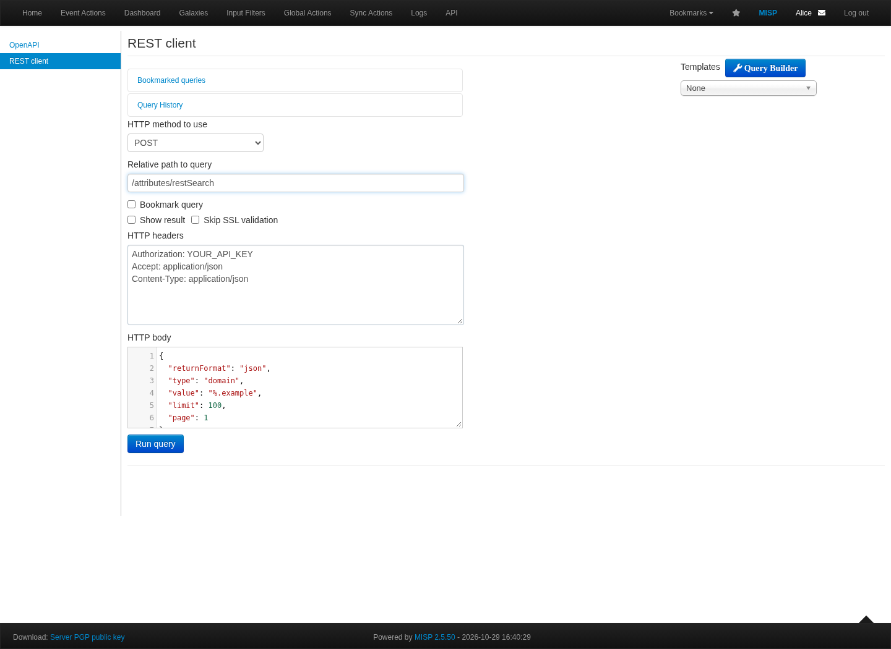

# Working with the MISP 2.5 REST API

**Find the right data, keep its context, automate with confidence.**

A practical course on authenticated requests, `restSearch`, export policies,
pagination, incremental retrieval and deliberate UUID-based updates.

[Slides](slide.tex) · [PDF](../output/a.7-rest-API.pdf) · [Presenter notes](content.tex) · [Notebook](REST-API-workshop.ipynb) · [Examples](examples/) · [Postman collection](postman/MISP-2.5-training.postman_collection.json) · [Training home](../README.md)

## Choose a starting point

| Goal | Start with |
| --- | --- |
| Try one query | [First request](#first-request) |
| Complete a bounded attribute export | [Python client](examples/search_attributes.py) |
| Use typed Python objects | [PyMISP example](examples/pymisp_search.py) |
| Explore interactively | [Read-only notebook](REST-API-workshop.ipynb) or [Postman](#postman-and-the-built-in-rest-client) |
| Practise create, edit and delete | [Disposable workshop](#workshop-a-private-event-from-start-to-finish) |
| Review the implementation evidence | [Source audit and validation](#source-audit-and-validation) |
| Consult older notebooks and slides | [Archived lesson](../archive/slide-decks/a.7-rest-API-v1/README.md) |

The deck has **33 pages**: a title, 29 content slides with presenter notes and
three section pages. Allow 40–50 minutes for the slides and 30–40 minutes for the
workshop. Learners
need basic HTTP/JSON knowledge and an API-enabled training account. Read-only
exercises need no administrative role; writes require the relevant permissions.

Reviewed against **MISP 2.5.50**, commit
[fc99c9e3fc85beddc6ef18835359f3c8b7f44608](https://github.com/MISP/MISP/tree/fc99c9e3fc85beddc6ef18835359f3c8b7f44608),
on 29 October 2026. The examples use Python 3.12, Requests 2.34.2 and
PyMISP 2.5.34.4. Feature availability and response details depend on the deployed
patch level, role, settings and export format.

## First request

Set `MISP_URL` to the instance base URL without a trailing slash, including any
deployment subdirectory.
Set `MISP_API_KEY` through your local secret-management mechanism. Keep both
outside committed scripts, notebooks, collection exports and shell history.
Use trusted HTTPS; for a private CA, set `CURL_CA_BUNDLE` and
`REQUESTS_CA_BUNDLE` to a suitable CA bundle instead of disabling verification.

```sh
curl --fail-with-body --silent --show-error --connect-timeout 5 --max-time 60 \
  -H "Authorization: $MISP_API_KEY" -H 'Accept: application/json' \
  "$MISP_URL/servers/getVersion"
```

The header contains the **raw key**, without a `Bearer` prefix. The response
includes `version` and `pymisp_recommended_version`. Use the instance's
`/api/openapi` and `/api/rest` pages to explore the deployed API; the older
`/servers/rest` page redirects to the current REST client.

For an attribute query, run from this directory:

```sh
curl --fail-with-body --silent --show-error --connect-timeout 5 --max-time 60 \
  -H "Authorization: $MISP_API_KEY" \
  -H 'Accept: application/json' -H 'Content-Type: application/json' \
  --data-binary @examples/attribute-search.json \
  "$MISP_URL/attributes/restSearch"
```

This asks for one page of domain attributes ending in the reserved `.example`
namespace. Empty results are expected until the workshop creates synthetic
data. Both publication and `to_ids` states are explicitly included. It does not
download attachments or change records.

Advanced auth keys can have an expiration, allowed IP ranges and read-only
restriction. They still inherit the account's data visibility and applicable
role permissions. **Read-only describes permitted operations, not HTTP verbs**:
a read-only key can POST `restSearch` and cannot create an event. The account
also needs `perm_auth`. Never assume a site-admin's result matches an analyst's.

## Choose the scope before the filters

| Task | Endpoint | Raw JSON response |
| --- | --- | --- |
| Inspect instance capabilities | `GET /servers/getVersion` | Object with version/capability fields |
| List event summaries | `POST /events/index` | Flat array of event summary objects |
| Retrieve full events or metadata | `POST /events/restSearch` | `{"response":[{"Event":{...}}]}` |
| Retrieve matching attributes | `POST /attributes/restSearch` | `{"response":{"Attribute":[...]}}` |
| Retrieve one known event | `GET /events/view/{uuid}` | `{"Event":{...}}` |

Current source also supports `restSearch` for objects, sightings and galaxy
clusters, with their own parameters and formats. The filter list is not
universal across scopes.

An event search selects matching **events**; its full JSON export can include
attributes beyond the matching attribute type/value. Choose attribute scope
when each returned row must satisfy the attribute query. Use
[event-search.json](examples/event-search.json) with `metadata: true` for a
lighter event result. Metadata is not the same thing as a full event with zero
attributes.

PyMISP normalises responses and, with `pythonify=True`, returns typed objects.
Do not apply the raw HTTP envelope parser to those results.

## Build filters deliberately

| Input | Meaning in these examples |
| --- | --- |
| `type: "domain"` | Attribute type; PyMISP calls this `type_attribute` |
| `value: "%.example"` | Suffix wildcard; a plain string is an exact match |
| `eventinfo: "%REST API training%"` | Explicit substring match on event information |
| `published: 1` / `0` / `[0,1]` | Published / unpublished / either state |
| `to_ids: 1` / `0` / `[0,1]` | Detection-marked / contextual / either state in raw JSON |
| `includeEventUuid: true` | Include the event UUID with attribute results |
| `includeEventTags: true` | Include inherited event tags, marked `inherited` |

Use the documented numeric search flags here. Boolean/string coercion differs
between endpoints and clients; in this snapshot a literal JSON `false` may
skip a filter rather than select the `0` state. The tested PyMISP version also
rejects a `to_ids=[0,1]` argument despite the raw endpoint supporting that array.
For its non-restrictive JSON search, omit `to_ids` to include both states.

Tag filters support explicit operators:

```json
{
  "tags": {
    "AND": ["tlp:clear"],
    "OR": ["training:reviewed", "training:verified"],
    "NOT": ["training:exclude"]
  }
}
```

This requires the AND tag, at least one OR tag, and no NOT tag. It is an
illustration: create those custom tags first if you want matching fixtures.
Event and attribute tag attachments can both influence selection; inspecting
only tags directly attached to a returned attribute can be misleading.
Tag selection is a filter, not an access-control grant.

## Analyst retrieval and detection export have different defaults

JSON and CSV exporters are non-restrictive in the reviewed source. Detection
formats such as text apply `published=1` and `to_ids=1` defaults when omitted.
Changing only `returnFormat` can therefore change the selected records.
Set the policy explicitly before comparing results.

[detection-export.json](examples/detection-export.json) selects published,
detection-marked `.example` domains with `tlp:clear`, excludes a training tag and
enforces enabled warninglists. Its response is text, not a JSON envelope.
An unpublished workshop event correctly produces no matching detection output.
Treat this as a policy exercise; synthetic output is not a production blocklist.

`includeWarninglistHits` annotates JSON results; `enforceWarninglist` can remove
matching rows. Post-query filtering can produce short or empty output pages
even when later candidates exist. Do not reuse a plain-JSON pagination loop
unchanged for those exports. Also consider expiry/decay, handling restrictions
and the destination tool's capabilities before deploying indicators.

## Pagination: a page is not an export

- `page` starts at **1**. `limit` is scope-specific: events versus attributes.
- A role can cap the requested limit. The event cap is derived differently
  from the attribute cap in this source.
- A short page is not proof of completion. In the test lab, a request for 100
  attributes returned 2 per page because of the role limit, yet 5 were available.
- `X-Result-Count` is endpoint-specific. On `restSearch` it reports this render's
  element count; do not assume it is a global total or a cursor.
- Stable ordering reduces drift but does not freeze concurrent edits.

The [Python example](examples/search_attributes.py) is intentionally limited
to ordinary JSON queries with the listed SQL filters. It requests
`Attribute.id ASC`, continues until an empty page and fails on repeated UUIDs,
invalid responses, redirects or the maximum-page bound. It does not silently
mark a truncated export successful. Unknown/post-query filters are rejected.

Install the tested dependencies in a virtual environment:

```sh
python3 -m venv .venv
. .venv/bin/activate
python -m pip install -r examples/requirements.txt
python -m unittest discover -s examples -p 'test_*.py'
python examples/search_attributes.py --page-size 100 --max-pages 20 \
  > attributes.ndjson.tmp && mv attributes.ndjson.tmp attributes.ndjson
python examples/pymisp_search.py
```

The temporary file is published only on successful traversal. A failure can
leave partial output in `.tmp`. The script never saves a checkpoint. Its HTTP
and response-validation errors contain no request headers or response bodies.
Requests retains normal proxy and CA handling; the only allowed HTTP exception
is an isolated loopback lab.

The PyMISP companion deliberately fetches **one page**. It uses `PyMISP`,
`type_attribute` and `pythonify=True`, checks for error dictionaries and prints
only UUIDs/types. It does not claim to implement a complete export.

## Incremental retrieval needs a consumer policy

| Field | Clock |
| --- | --- |
| Attribute `timestamp` / `attribute_timestamp` | Attribute change time |
| `event_timestamp` | Parent event change time |
| `publish_timestamp` / `last` | Event publication time |
| `from` / `to` | Event date bounds |
| `first_seen` / `last_seen` | Observation time, not API ingestion time |

For a repeatable polling window, capture an upper Unix timestamp at run start
and query `timestamp: [lower, upper]`. Reuse the same bounds for every page.
The timestamp range is inclusive. Add a deliberate overlap, upsert by UUID and
advance the checkpoint only after **all** pages and downstream writes succeed.
Choose a first-run backfill policy rather than inventing a previous checkpoint.

An attribute-change poll alone does not capture every event-tag/visibility
change. Normal search also omits soft-deleted records. Plan separately for
tombstones, revocations, hard deletions and loss of access, with reconciliation
and a retention/expiry policy. This lesson is not a replacement for MISP
server-to-server synchronisation.

Deletion visibility is permission-dependent. In this reviewed snapshot,
attribute `restSearch` with `deleted:1` returned a tombstone to a sync-capable
administrator but not an ordinary owning user. That owner could inspect the
deleted attribute through `/events/view/{uuid}/deleted:1`. Do not interpret an
empty deletion search as proof that nothing was deleted, or grant sync
privileges just to complete a training exercise.

## Workshop: a private event from start to finish

Use a disposable instance and a writer account permitted to add/modify its own
event. The notebook and Postman collection stay read-only; these curl commands
perform the deliberate writes. Keep the event unpublished and organisation-only.

1. POST [create-event.json](examples/create-event.json) to `/events/add`.
   Read `Event.uuid` from the response and set `EVENT_UUID` locally. The omitted
   date defaults to the server's current date.
2. POST [add-attribute.json](examples/add-attribute.json) to
   `/attributes/add/$EVENT_UUID`. Save the returned `Attribute.uuid` as
   `ATTRIBUTE_UUID`; avoid fixed numeric IDs.
3. Retrieve the event and run the attribute query. Explain why the unpublished,
   `to_ids=false` observation is visible to the owning organisation's reader.
4. POST [edit-attribute.json](examples/edit-attribute.json) to
   `/attributes/edit/$ATTRIBUTE_UUID`. Verify the comment with
   `GET /attributes/view/$ATTRIBUTE_UUID`.
5. Repeat the reads with a read-only key. Confirm an event-creation request is
   denied. A user in another organisation must not see this private fixture.
6. Deliberately soft-delete the workshop attribute with
   `POST /attributes/delete/$ATTRIBUTE_UUID`. Confirm it disappears from the
   normal event view; inspect the owning user's `deleted:1` event view.
7. Remove the disposable event through `POST /events/delete/$EVENT_UUID` and
   retire the training keys according to your lab's procedure.

Use the same headers/timeouts as the first request, for example:

```sh
curl --fail-with-body --silent --show-error --connect-timeout 5 --max-time 60 \
  -H "Authorization: $MISP_API_KEY" \
  -H 'Accept: application/json' -H 'Content-Type: application/json' \
  --data-binary @examples/create-event.json "$MISP_URL/events/add"
```

Send **small explicit edit payloads**. Replaying a complete fetched object can
include stale timestamps, distribution or unrelated fields. Re-read after a
conflict; do not blindly retry a timed-out create operation, since it may have
already succeeded. UUIDs support identity and reconciliation, not universal
idempotency for every endpoint. Publishing is a separate operation that can
trigger synchronisation or alerts; it is not a prerequisite for querying one's
own unpublished event.

## Postman and the built-in REST client

Import the [collection](postman/MISP-2.5-training.postman_collection.json) and
[blank-key environment](postman/MISP-2.5-training.postman_environment.json).
Set `base_url` and the secret `api_key` locally. The five read-only requests cover
version, attribute JSON, event metadata, policy text and CSV, with ten response
assertions. Each search is one page. Do not export/share the filled environment.



The real `/api/rest` page provides templates, query building, history/bookmarks
and request-code generation. Review generated code before reuse: replace
embedded keys with local configuration, set timeouts and retain TLS validation.
The screenshot shows a prepared request with `YOUR_API_KEY` and was not
submitted. See [capture provenance](images/README.md).

## Diagnose failures before widening the query

| Observation | Check |
| --- | --- |
| 401/403 | Key validity, expiration, source IP, API permission and endpoint permissions; invalid keys returned 403 in this lab |
| 404 | Base path, endpoint, object existence and caller visibility |
| 400/405 or JSON error | Method, JSON, field types and validation; inspect the endpoint's actual message locally |
| HTML or redirect | Login/proxy response or wrong URL; do not parse it as an empty result |
| 429, timeout or 5xx | Limits and server health; bounded backoff for safe reads, no blind write retries |
| 200 with no records | Scope, exact/wildcard match, flags, tags, dates, ACLs and exporter defaults |

Do not rely on status alone: validate the expected response shape and check
PyMISP error dictionaries. Start with one known UUID and add filters one at a
time. Protect diagnostic files as carefully as exported intelligence.

## Build and source audit

Use the repository's [theme setup](../themes/README.md), then from its root:

```sh
export TEXINPUTS="$PWD/themes:${TEXINPUTS:-}:"
mkdir -p /tmp/misp-rest-slides
cd a.7-rest-API
for pass in 1 2 3; do
  pdflatex -interaction=nonstopmode -halt-on-error \
    -output-directory=/tmp/misp-rest-slides slide.tex || exit 1
done
```

The standard [build](../build.sh) includes this course and generates a
presenter-notes handout with the shared MISP 2.0 visual identity. Continue with
[PyMISP](../a.2-pymisp/) for broader client usage or
[restSearch export-module development](../a.9-restsearch-dev/) for exporter internals.

## Source audit and validation

Pinned MISP sources:

- [OpenAPI contract](https://github.com/MISP/MISP/blob/fc99c9e3fc85beddc6ef18835359f3c8b7f44608/app/webroot/doc/openapi.yaml) and [REST client controller](https://github.com/MISP/MISP/blob/fc99c9e3fc85beddc6ef18835359f3c8b7f44608/app/Controller/ApiController.php).
- [Shared restSearch controller](https://github.com/MISP/MISP/blob/fc99c9e3fc85beddc6ef18835359f3c8b7f44608/app/Controller/AppController.php), [scope-specific parameters](https://github.com/MISP/MISP/blob/fc99c9e3fc85beddc6ef18835359f3c8b7f44608/app/Controller/Component/RestSearchComponent.php) and [role result caps](https://github.com/MISP/MISP/blob/fc99c9e3fc85beddc6ef18835359f3c8b7f44608/app/Model/User.php).
- [Attribute search, tag logic and deletion visibility](https://github.com/MISP/MISP/blob/fc99c9e3fc85beddc6ef18835359f3c8b7f44608/app/Model/MispAttribute.php), [event search and time filters](https://github.com/MISP/MISP/blob/fc99c9e3fc85beddc6ef18835359f3c8b7f44608/app/Model/Event.php), [auth-key restrictions](https://github.com/MISP/MISP/blob/fc99c9e3fc85beddc6ef18835359f3c8b7f44608/app/Model/AuthKey.php) and [JSON exporter](https://github.com/MISP/MISP/blob/fc99c9e3fc85beddc6ef18835359f3c8b7f44608/app/Lib/Export/JsonExport.php).
- [PyMISP API at 95d63aa6defbb0f37966a637d426ddae837eae7c](https://github.com/MISP/PyMISP/blob/95d63aa6defbb0f37966a637d426ddae837eae7c/pymisp/api.py).

Validated on the reviewed MISP source with MariaDB 10.11 and Valkey 7.2:
14 offline Python client tests; real two-organisation access checks; a read-only
key's successful POST searches and denied write; role-capped traversal of all
five visible domains; event/attribute envelopes; tag AND/OR/NOT and inheritance;
numeric flags and timestamp bounds; text/CSV exports; PyMISP typed results;
UUID-based create/add/edit/soft-delete and permission-dependent tombstone views.
The five Postman requests passed all ten Newman assertions.

Offline tests substitute HTTP responses to verify client failure/pagination
boundaries. They do not prove server behaviour; the separate live checks do.
All notebook code cells ran successfully against the lab without changing the
committed notebook; it contains no keys, execution counts or outputs. The ordinary
writer also completed event cleanup, with subsequent view returning HTTP 404.
