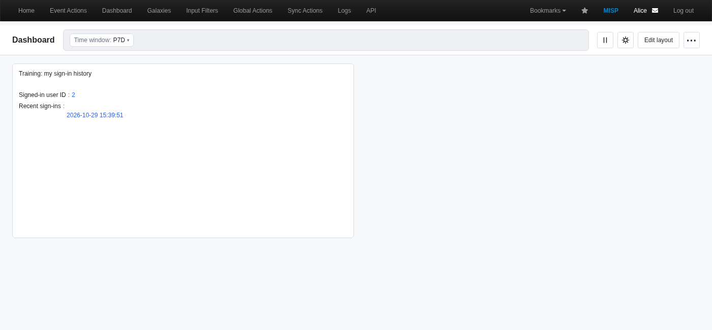
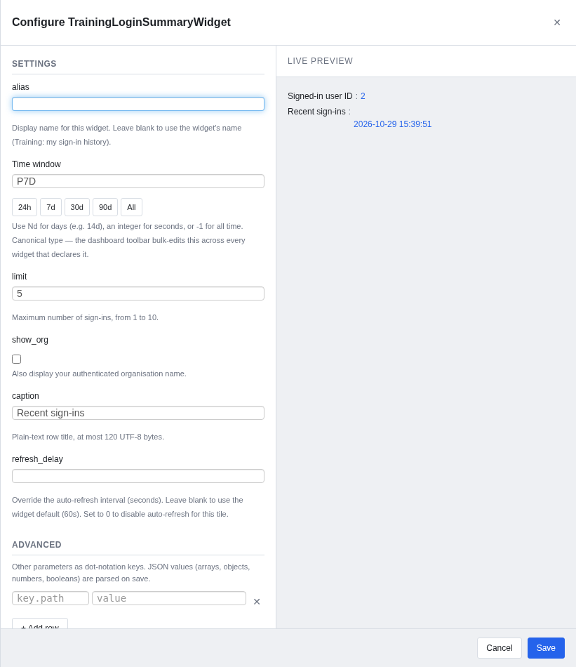

# Building dashboard widgets in MISP 2.5

**From a PHP handler to a typed, permission-aware dashboard widget.**

Build a widget for the dashboard **inside MISP**, at `/dashboards`. Learn how
discovery, configuration, canonical filters, rendering and caching fit together,
then verify the result as two users.

[Slides](slide.tex) · [Presenter notes](content.tex) · [Working PHP example](examples/TrainingLoginSummaryWidget.php) · [Contract checks](examples/verify_widget.php) · [Dashboard user course](../6.0-misp-dashboard/README.md) · [Training home](../README.md)



## Start here

| You want to… | Read or use |
| --- | --- |
| Teach the development workflow | [Slide source](slide.tex) and [presenter notes](content.tex) |
| Install and try the example | [Workshop](#workshop-build-test-remove) |
| Understand typed filters and defaults | [Configuration contract](#configuration-contract) |
| Review data isolation and freshness | [Permissions and caching](#permissions-and-caching) |
| Port an older widget | [Migration guide](#migrating-an-older-widget) |
| Consult the earlier lesson | [Archived source, images and original PDF](../archive/slide-decks/a.a-widget-dev-v1/README.md) |

The deck has **29 pages**: a title, 25 content slides with presenter notes and
three section pages. Allow 35–45 minutes for the presentation and 25–35 minutes
for the workshop.
Learners need PHP/CakePHP familiarity, an isolated MISP installation and access
to install one custom file. Using the widget does **not** require site-admin
privileges; installing server code is an operator/developer task.

Reviewed and exercised against **MISP 2.5.50**, commit
[fc99c9e3fc85beddc6ef18835359f3c8b7f44608](https://github.com/MISP/MISP/tree/fc99c9e3fc85beddc6ef18835359f3c8b7f44608),
on 29 October 2026. Check your deployed patch level and theme before teaching.
These are contracts in that snapshot, not a claim that every feature existed
in the first 2.5 release.

## The model in one pass

1. MISP discovers `*Widget.php` classes in `app/Lib/Dashboard/` and
   `app/Lib/Dashboard/Custom/`, including one level of custom subdirectories.
   `checkPermissions($user)` gates discovery and loading.
2. Metadata describes the gallery entry; `$schema` describes typed settings.
   The configure panel and supported shared-filter controls use those types.
3. `POST /dashboards/renderWidget` loads the widget, applies schema defaults
   for **missing** keys and translates canonical values through
   `CanonicalTypeAdapter`.
4. `WidgetCache` may return a cached payload. On a miss, MISP calls
   `handler($user, $options)`.
5. The selected `$render`, or `getRenderer($config)`, consumes the returned data.
   The normal browser path renders HTML; REST returns a data envelope.

Class name and filename must match. Use a unique name ending in `Widget`.
The built-in path takes precedence over Custom: the exercise uses
`TrainingLoginSummaryWidget` and leaves the existing `WhoamiWidget` alone.
There is no manual registration list to edit.

## Workshop: build, test, remove

### 1. Prepare a disposable board

Use a training instance with normal session/API authentication. Create two
ordinary users in the **same organisation** and sign in as each at least once
to generate genuine login audit records. API authentication alone need not
produce an interactive-login record.

Export your personal board through **More → Export configuration** before
importing the example layout. An import replaces the current user's saved board.
Use an isolated lab for installing the training PHP.

### 2. Install the one PHP file

From this repository's root, set `MISP_DIR` to your installation:

```sh
MISP_DIR=/var/www/MISP
install -m 0644 a.a-widget-dev/examples/TrainingLoginSummaryWidget.php \
  "$MISP_DIR/app/Lib/Dashboard/Custom/TrainingLoginSummaryWidget.php"
php -l "$MISP_DIR/app/Lib/Dashboard/Custom/TrainingLoginSummaryWidget.php"
php a.a-widget-dev/examples/verify_widget.php "$MISP_DIR"
```

Run the copy with the privileges your installation requires. The directory must
already exist and the PHP worker must be able to read the file. Use the PHP
runtime matching your MISP deployment; in a container, copy and run there.
The verifier needs the installed CakePHP submodule and the reviewed dashboard
helpers, but does not bootstrap MISP, connect to SQL or require an API key.

Open **Edit layout → Add widget**, search for **Training: my sign-in history**,
add it and **Save changes**. Alternatively import
[layout.json](examples/layout.json) through **More → Import configuration**.

### 3. Configure and inspect



| Setting | Example | Expected behaviour |
| --- | --- | --- |
| `lookback` | `"P7D"` | Canonical time window; adapter supplies `"7d"` to the handler |
| `limit` | `5` | Integer, 1–10 results, newest first |
| `show_org` | `false` | Real boolean; `"false"` is invalid |
| `caption` | `"Recent sign-ins"` | Plain UTF-8 text, 1–120 bytes, no control characters |

Save a caption such as `<b>Plain text</b>` and enable the organisation checkbox.
The caption should appear literally, not as bold HTML. The organisation comes
from the authenticated context. Try the time-window toolbar: the widget declares
`time_window` under **lookback**, so the shared control can reach it.

The query explicitly restricts `Log.user_id` to the authenticated user and
`Log.action` to `login`. It selects only timestamps, with a deterministic order
and a hard limit. All-time mode (`-1`) removes the time cutoff but retains the
limit. An empty result says **No matching sign-ins.** SQL errors propagate;
the widget does not present a failure as an empty history.

### 4. Exercise the API

Use an API-enabled training account and your instance's normal trusted TLS
configuration. From this directory, with `MISP_URL` and `MISP_API_KEY` already
set locally:

```sh
curl --fail-with-body --silent --show-error \
  -H "Authorization: $MISP_API_KEY" \
  -H 'Accept: application/json' -H 'Content-Type: application/json' \
  --data-binary @examples/render-request.json \
  "$MISP_URL/dashboards/renderWidget"
```

The response contains `instance_id`, `widget`, `config`, `renderer` and `data`.
The config has already passed through the adapter; the window is `"7d"`.
Data is an array of `{title, value}` rows.

Use the same POST with `/dashboards/renderWidget/exportjson:1` for **bare handler
data**, or `/dashboards/renderWidget/exportcsv:1` for flattened CSV. JSON success
alone does not verify the HTML renderer. Keep normal browser CSRF/session
protection enabled.

### 5. Verify boundaries

- Render as user A, then B, then A again with identical options, within the
  30-second TTL. Each result must show that account's own ID and login times.
  Same-organisation users still have separate personal data.
- Try `{"show_org":"false"}`, `{"limit":11}`, `{"lookback":null}` and
  `{"user_id":123}` as config objects. Each must return HTTP 400.
- Save typed settings in the browser, reload, and confirm persistence.
  Check literal caption rendering and the empty state as well as JSON exports.
- Refresh within the TTL and after expiry. A manual refresh can use cached data.
  For debugging, temporarily set `cache_duration = 0` to run live; restore the
  example before comparing cache behaviour.

The verifier runs **59 checks** against the real adapter, schema validator,
cache-key helper and `SimpleList` template, using actual CakePHP escaping.
Its only application-data substitute is an in-memory `Log::find` query recorder.
It checks query shape, invalid input, identity, escaping, cache keys and error
propagation. It does **not** prove SQL execution, HTTP routing, Redis operation
or browser integration; perform the live steps too.

### 6. Clean up

Remove the training widget from your board and save, restore your exported
layout if needed, then remove the installed
`app/Lib/Dashboard/Custom/TrainingLoginSummaryWidget.php` file. Remove disposable
accounts/data according to your lab's procedure. This is a teaching widget,
not a proposal to add a second personal-status widget to MISP core.

## Configuration contract

`$schema` entries declare `type`, optional `default`, `help` and `required`.
An `enum` needs an `enum` value list; `enum_labels` supplies readable labels.
`$params` still documents advanced legacy parameters; `$placeholder` is a valid
JSON example, not an access-control or validation mechanism.

| Type family | Types | Shared toolbar |
| --- | --- | --- |
| Time | `time_window`, `date_range` | Yes |
| Tags and context | `tag_filter`, `org_filter`, `org_meta_filter`, `sharing_group_filter`, `galaxy_cluster_filter` | Yes |
| Event classification | `distribution_filter`, `threat_level_filter`, `analysis_filter` | Yes |
| Widget-specific canonical inputs | `attribute_type_filter`, `event_id_filter` | No |
| Scalars | `string`, `int`, `bool`, `enum` | No |

Toolbar reachability follows the **declared type**, not the parameter's name.
Adding a schema does not make every setting a board-wide filter.

Defaults apply only when a key is absent. Explicit `null` and empty strings
survive and must be handled deliberately. For this example, `P7D → 7d`,
`P2W → 14d` and `PT6H → 21600` seconds; legacy day strings, integer seconds
and `-1` also reach the handler. Unknown shapes can pass through. This is not
blanket handler validation: validate types, ranges, allowed keys and data access
in server code. The example rejects unknown options and explicit invalid values.

## Permissions and caching

`checkPermissions` answers **may this user load this widget?** It does not
automatically scope a model query. Detailed event widgets should use the
appropriate MISP ACL-aware retrieval methods with the requesting user.
Some core widgets intentionally report instance-wide aggregates; inspect the
particular widget before copying its query.

| Concern | Example decision |
| --- | --- |
| Data boundary | Always query authenticated `Log.user_id` |
| Output | Plain timestamps and optional authenticated organisation; no IPs or emails |
| SQL work | At most 10 returned rows, selected fields, stable order |
| Refresh interval | `$autoRefreshDelay = 60` seconds |
| Cache TTL | `$cache_duration = 30` seconds |
| Cache identity | `$cache_scope = 'user'` |

With only `cache_duration`, the default cache key is shared by configuration.
That is suitable only for output identical for all viewers. `'user'` adds a
user ID; `'org'` shares an organisation bucket and keeps site admins in a
separate unrestricted bucket. Choose from the actual identity dependence of
the output. Personal history needs **user**, even within one organisation.

The framework hashes translated, sorted config, excluding `alias` and
`refresh_delay`. Those fields must not change handler data; changing them does
not invalidate the cache. A cache hit bypasses the handler. Manual refresh need
not bypass the TTL. Redis failures fall back to live computation. The legacy
`cacheLifetime` property does not enable this cache.

## Rendering without creating a second dashboard framework

Reuse an existing renderer where possible. `SimpleList` accepts rows with
`title` and scalar/array `value`; both are escaped by the template. Return plain
strings, not pre-escaped strings. `drilldown` links go through
`DashboardURLValidator`: relative and approved origins are permitted; dangerous
schemes and arbitrary off-host URLs are dropped. The allowlist also includes
the configured CVE reference origin.

Avoid `html` and `html_title` for user-derived content: those legacy fields
deliberately bypass escaping. PHP elements live at
`app/View/Elements/dashboard/Widgets/`; chart modules and the board UI live under
`app/webroot/js/dashboard/`. Reuse theme tokens and accessible markup. A new
renderer also needs preview handling in
`app/webroot/js/dashboard/gallery/render-thumbs.mjs`. Test empty/error states, resize,
theme and keyboard use; retain the board's existing framework/vendor JS.

## Layout and persistence are separate from data

[layout.json](examples/layout.json) is a **bare array** of widgets with a stable
`instance_id`, class name, `config` and `position: {x, y, w, h}`. Copying a
layout never grants data access. `GET /dashboards` gives the current layout for
REST callers; export wraps saved settings in a `UserSetting` object.

Add/move/resize/remove are staged until **Save changes**. Configuration saves
and toolbar changes persist settings separately through `updateWidgetSettings`.
Layout **Discard** does not undo every configuration save. Shared templates are
stored in `Dashboard`; the saved personal board is a `UserSetting`.

## Migrating an older widget

| Earlier lesson | Current approach |
| --- | --- |
| `WhoAmI.php` / class mismatch and built-in name collision | Unique `TrainingLoginSummaryWidget.php` / `TrainingLoginSummaryWidget` |
| Mostly `$params` and JSON examples | Add `$schema`; retain compatible advanced options deliberately |
| Hand-parse every time-window wire format | Declare `time_window`; understand the adapter and validate its output |
| `cacheLifetime` | `cache_duration` plus explicit scope for identity-dependent data |
| Private query with an implicit shared cache | Own-user query **and** user-scoped cache |
| Generic renderer path / old HTML assumptions | Actual `dashboard/Widgets` element and its data contract |
| Size-only layout snippets | Stable instance IDs and `position.x/y/w/h` |
| Ad hoc inspection | Offline checks plus real HTTP, Redis and browser verification |

Port incrementally: preserve public config compatibility where necessary,
inspect saved boards, test the two-account boundary, then document any deliberate
config migration. A schema alone does not migrate saved values or scope a query.

## Build the presentation

Use the repository's [theme setup](../themes/README.md). From its root:

```sh
export TEXINPUTS="$PWD/themes:${TEXINPUTS:-}:"
mkdir -p /tmp/misp-widget-slides
cd a.a-widget-dev
for pass in 1 2 3; do
  pdflatex -interaction=nonstopmode -halt-on-error \
    -output-directory=/tmp/misp-widget-slides slide.tex || exit 1
done
```

The standard [build script](../build.sh) includes `a.a-widget-dev` and also creates
the presenter-notes handout. This course uses the shared MISP 2.0 visual identity,
short examples and notes for the longer explanations.

## Source audit and validation

All MISP links below are pinned to the reviewed commit:

- [Dashboard discovery and template model](https://github.com/MISP/MISP/blob/fc99c9e3fc85beddc6ef18835359f3c8b7f44608/app/Model/Dashboard.php)
- [Controller: rendering, gallery, schema and persistence](https://github.com/MISP/MISP/blob/fc99c9e3fc85beddc6ef18835359f3c8b7f44608/app/Controller/DashboardsController.php)
- [WidgetSchema](https://github.com/MISP/MISP/blob/fc99c9e3fc85beddc6ef18835359f3c8b7f44608/app/Lib/Dashboard/Tools/WidgetSchema.php), [CanonicalTypeAdapter](https://github.com/MISP/MISP/blob/fc99c9e3fc85beddc6ef18835359f3c8b7f44608/app/Lib/Dashboard/Tools/CanonicalTypeAdapter.php) and [WidgetCache](https://github.com/MISP/MISP/blob/fc99c9e3fc85beddc6ef18835359f3c8b7f44608/app/Lib/Dashboard/Tools/WidgetCache.php)
- [SimpleList renderer](https://github.com/MISP/MISP/blob/fc99c9e3fc85beddc6ef18835359f3c8b7f44608/app/View/Elements/dashboard/Widgets/SimpleList.ctp), [URL validator](https://github.com/MISP/MISP/blob/fc99c9e3fc85beddc6ef18835359f3c8b7f44608/app/Lib/Dashboard/Tools/DashboardURLValidator.php) and [renderer previews](https://github.com/MISP/MISP/blob/fc99c9e3fc85beddc6ef18835359f3c8b7f44608/app/webroot/js/dashboard/gallery/render-thumbs.mjs)
- [Log model](https://github.com/MISP/MISP/blob/fc99c9e3fc85beddc6ef18835359f3c8b7f44608/app/Model/Log.php) and [existing Whoami widget](https://github.com/MISP/MISP/blob/fc99c9e3fc85beddc6ef18835359f3c8b7f44608/app/Lib/Dashboard/WhoamiWidget.php)

Validated with PHP 8.4.27, MariaDB 10.11, Valkey 7.2 and Chromium against that
source: 59 offline checks; same-organisation user A/B/A renders; HTTP 400 cases;
wrapped/bare JSON and CSV responses; real per-user Redis keys and TTLs; layout
import/readback; gallery discovery; typed caption/boolean saves, reload persistence
and literal HTML escaping in the browser.
See [screenshot provenance](images/README.md). This validates the teaching
example, not every MISP widget or release.
