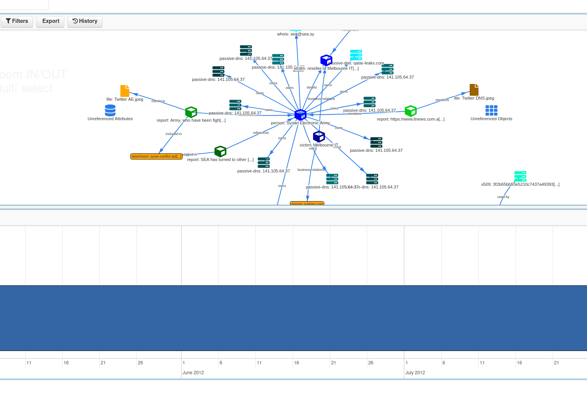

# Sample MISP events

**Ready-to-use JSON events for training, workshops, and exercises.**

Choose a scenario to demonstrate MISP features or give participants material
to investigate in a training instance.

[Training home](../../README.md) · [All exercises](../../exercises/) · [Training VMs](https://vm.misp-project.org/)

## Real-world case studies

| Event | Features to explore |
| --- | --- |
| [ATM deposit forgery vulnerabilities](atm-vulnerabilities-allow-deposit-forgery-attacks.json) | Finance-related Galaxy context and event reports |
| [Kobalos: threats to Linux HPC infrastructure](kobalos-linux-threat-to-hpc.json) | Event reports and event graphs |
| [Syrian Electronic Army investigation](syrian-electronic-army-domain-take-over.json) | Relationships, graphs, and timelines |
| [Targeted phishing and PDF phishkits](targeted-phishing-pdf-phishkit-yara.json) | YARA tracking and graph analysis |

## Synthetic scenarios

| Event | Features to explore |
| --- | --- |
| [Dirty Harry](dirty-harry-example.json) | Human relationships in a fictional movie scenario |
| [Indicator decay](sample-decaying-example.json) | Decaying indicators and their changing relevance |
| [Spear phishing against a telco](sample-spear-phishing-attempt-targeting-telco.json) | Encoding an incident from a narrative report |

For the telco scenario, use the [exercise narrative](sample-spear-phishing-attempt-targeting-telco.text)
alongside the example event to compare how the report becomes structured data.
